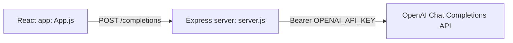

# react-chatgpt-clone

A ChatGPT-style chat interface built in React, with a small Express server that calls the OpenAI Chat Completions API. I built it in early 2023 to learn how chat products handle conversation state and history before I started building agents on Claude.

## What it does

- Chat with a model through a familiar sidebar-and-conversation layout
- Start new chats; previous conversations appear in the sidebar by title
- Keeps the API key on the server, never in the browser

## How it's put together



| File | Role |
| --- | --- |
| `App.js` | UI and client state: current chat, history, titles |
| `server.js` | Proxy to the OpenAI API so the key stays server-side |
| `index.js`, `index.css` | React entry point and styling |

These files are the `src` of a standard React app (Create React App or Vite).

## Run it

```bash
npm install express cors
export OPENAI_API_KEY=your-key
node server.js            # listens on port 8000
```

Then drop `App.js`, `index.js` and `index.css` into a new React app's `src/` folder and start it.

## What I'd do differently now

This was a learning project, and it shows its age. If I built it today:

- **Send the whole conversation, not just the last message.** The server currently sends one message, so the model has no memory of earlier turns
- **Stream responses** token by token instead of waiting for the full reply
- **Persist history** rather than keeping it in component state
- **Add tests** around the state handling in `App.js`
- **Move to a current model** and add guardrails and evals

My newer work on these ideas is in [telegram-claude-agent](https://github.com/bgildea/telegram-claude-agent), which handles multi-turn memory, tool use, guardrails and evaluation properly.

## Licence

MIT. See [LICENSE](LICENSE).
