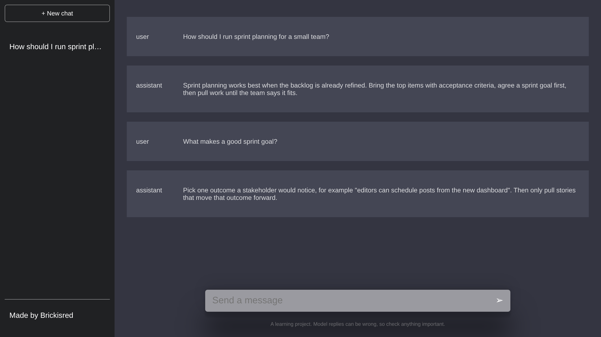
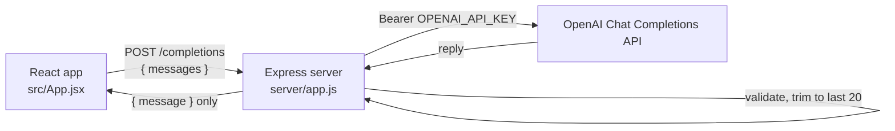

# react-chatgpt-clone

[](https://github.com/bgildea/react-chatgpt-clone/actions/workflows/ci.yml)


A chat interface built in React, with a small Express server that calls the OpenAI Chat Completions API. I first built it in early 2023 to learn how chat products handle conversation state. In November 2026 I came back to it and fixed what I had listed as its weaknesses: it now sends the whole conversation, validates input, has tests and runs in CI.



## What it does

- Chat with a model in a sidebar-and-conversation layout
- Multi-turn memory: every request carries the conversation so far, so follow-up questions work
- Start new chats and switch between them from the sidebar
- Keeps the API key on the server, never in the browser
- Shows a clear error when something fails, instead of failing silently

## How it's put together



| Path | Role |
| --- | --- |
| `src/App.jsx` | UI and client state: chats, messages, loading and errors |
| `server/app.js` | Validates the conversation and proxies it to the API |
| `server/index.js` | Starts the server on port 8000 |
| `tests/` | Vitest tests for the server and the UI |

### Guardrails on the server

- Only `user` and `assistant` roles are accepted, so a client cannot inject a `system` message
- At most 20 messages and 4,000 characters per message, with a 100 KB body limit, to keep costs bounded
- Bad input gets a 400 before any API call is made
- Upstream errors return a plain message, never the raw API response

## Run it

Needs Node 22.22 or later.

```bash
npm install
export OPENAI_API_KEY=your-key   # optional: OPENAI_MODEL, defaults to gpt-4o-mini
npm run server                   # API on port 8000
npm run dev                      # app on http://localhost:5173
```

Vite forwards `/completions` to the server, so the browser never sees the key.

## Tests

```bash
npm test        # 15 tests: message building, validation, error handling, multi-turn UI
npm run lint
```

The tests never call the real API: the server takes an injected `fetch`, and the UI test passes a fake one.

## What I'd still do next

- **Stream responses** token by token instead of waiting for the full reply
- **Persist history** so chats survive a page reload
- **Add evals** for answer quality, as I do in [telegram-claude-agent](https://github.com/bgildea/telegram-claude-agent), which covers tool use, guardrails and evaluation in more depth

## Licence

MIT. See [LICENSE](LICENSE).
